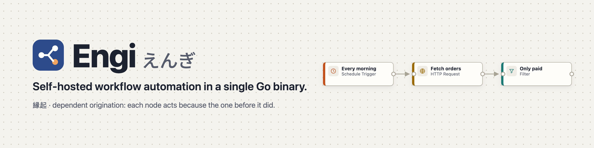

<h1 align="center"></h1>

**Self-hosted workflow automation, in a single Go binary.**

Engi connects your apps, databases and APIs into workflows you build on a visual canvas.
A workflow starts from a trigger (a webhook, a schedule, a Kafka message, an email), passes
data through nodes, and does something useful at the end. Engi runs on its own on a laptop
or a small server, and scales out on Kubernetes or Docker Swarm when the load grows.

> **Status: early, 0.x.** Engi is under active development and has not reached 1.0. Until then, APIs,
> node parameters and configuration may change in breaking ways. See the [CHANGELOG](CHANGELOG.md) for
> what changed, the [open issues](https://github.com/engi-hq/engi/issues) for known gaps, and the
> [roadmap](docs/12-roadmap.md) for what is planned.

## Why Engi

- **Runs on its own.** One binary with an embedded SQLite database and job queue. No Redis,
  no message broker, nothing else to install. About 30 MB of memory when idle.
- **Scales when you need it.** Point it at Postgres and run separate API, webhook, trigger and
  worker roles. The only required dependency is Postgres. Leader election, HA and autoscaling are
  built in, not paid extras.
- **Visual editor.** Build workflows on a canvas, run them, and inspect every node's input and output.
  Pin data, run up to a single node, and roll back to any saved version.
- **Code when you need it.** JavaScript expressions (`{{ $json.total * 1.2 }}`) in any field, plus a
  sandboxed Code node for anything the built-in nodes don't cover.
- **Your data stays yours.** Self-hosted, works air-gapped, no telemetry. Credentials are encrypted at
  rest (AES-256-GCM with key rotation).
- **Observable.** Prometheus metrics and OpenTelemetry traces, with one span per run and one per node.

## Quick start

### Run from source

You need Go 1.27+ (and Node.js 22 or newer, CI uses 24, if you want the editor UI).

```bash
git clone https://github.com/engi-hq/engi.git && cd engi
make build WEB=1                      # builds ./bin/engi with the editor embedded

export ENGI_ENCRYPTION_KEYS="k1:$(openssl rand -base64 32)"   # keep this key: it encrypts your credentials
export ENGI_ENCRYPTION_ACTIVE_KEY_ID=k1
export ENGI_AUTH_SESSION_COOKIE_SECURE=false                  # local HTTP only
./bin/engi serve
```

Open <http://localhost:8080>, create the owner account, and build your first workflow.

### Run with Docker Compose (Engi + Postgres)

No prebuilt image is published yet, so build it locally first:

```bash
make image IMAGE=engi:dev
cat > deploy/compose/.env <<EOF
POSTGRES_PASSWORD=change-me
ENGI_ENCRYPTION_KEYS=k1:$(openssl rand -base64 32)
EOF
docker compose -f deploy/compose/docker-compose.yml up -d
```

### Run a workflow from the command line

No server needed:

```bash
./bin/engi validate examples/switch-routing.workflow.json
./bin/engi run examples/switch-routing.workflow.json --input examples/switch-routing.input.json
```

## Your first workflow

The [`examples/`](examples) folder has small workflows you can import from the editor
(*Workflows → Import*) or run with `engi run`. A good first one is
[`sum-check-email.workflow.json`](examples/sum-check-email.workflow.json): it adds two numbers,
checks the result with an IF node, and sends an email only when it matches.

```
Manual Trigger → Set values → Add → IF (sum = 12?) ──true──→ Send Email
```

## Built-in nodes

| Category | Nodes |
|---|---|
| Triggers | Manual, Webhook, Schedule (interval / cron), Execute Workflow Trigger, Kafka, IMAP email |
| Flow | IF, Switch, Merge, Wait, Execute Workflow, Respond to Webhook, No-Op |
| Transform | Edit Fields (Set), Filter, Sort, Limit, Split Out, Aggregate |
| Code | JavaScript, Python (`engi.code.python`, see [Python Code node](docs/15-plugins.md#158-python-code-node)) |
| HTTP | HTTP Request (auth, JSON/form/binary bodies, binary responses) |
| Databases | Postgres, MySQL, Redis, MongoDB |
| Streaming | Kafka producer |
| Storage | S3 / MinIO |
| Email | Send Email (SMTP) |
| Chat | Slack, Telegram, Microsoft Teams |

Every node's parameters, ports and credentials are listed in the [Node Reference](docs/nodes/README.md).
For anything else, the HTTP Request node talks to any REST API.

## Deploy

| Where | How |
|---|---|
| Laptop or single server | `engi serve` (SQLite, all roles in one process) |
| Single host with Postgres | [`deploy/compose`](deploy/compose) |
| Kubernetes (AKS, EKS, GKE, on-prem) | Helm chart in [`deploy/helm/engi`](deploy/helm/engi): one Deployment per role, KEDA autoscaling, Kubernetes Lease leader election |
| Docker Swarm | [`deploy/swarm/docker-stack.yml`](deploy/swarm/docker-stack.yml): Docker secrets, per-role services, Postgres leader lock |

All settings are environment variables (`ENGI_*`), a YAML file or flags. See
[Deployment & Configuration](docs/11-deployment.md) for the full reference.

## How it works

```
 triggers ──► job queue ──► workers ──► nodes ──► your systems
 (webhook,    (SQLite or    (run the
  schedule,    Postgres)     engine)
  Kafka, …)
```

Engi is written in Go with a clean, ports-and-adapters architecture: the engine and domain have no
knowledge of HTTP, SQL or vendors, so storage, queues and buses are swappable adapters.
The editor is React + TypeScript and ships inside the binary. Read the
[architecture overview](docs/02-architecture.md) for details.

## Documentation

The full documentation is at **<https://engi-hq.github.io/docs/>**. The same pages are in [`docs/`](docs/README.md).

- [Vision & principles](docs/01-vision.md)
- [Architecture](docs/02-architecture.md) · [Data model](docs/03-data-model.md) · [Execution engine](docs/04-engine.md)
- [Expressions](docs/05-expressions.md)
- [Triggers & webhooks](docs/08-triggers.md) · [Credentials](docs/07-data-sources.md)
- [HTTP API](docs/09-api.md) ([OpenAPI spec](docs/api/openapi.yaml))
- [Deployment & configuration](docs/11-deployment.md)
- [Node Reference](docs/nodes/README.md)

## Changelog

See [CHANGELOG.md](CHANGELOG.md) for what is new.

## Contributing

Contributions are welcome. Start with [CONTRIBUTING.md](CONTRIBUTING.md). The
[Developer Guide](docs/13-dev-guide.md) has the details. Report security issues privately, as described in
[SECURITY.md](SECURITY.md). Everyone taking part follows the [Code of Conduct](CODE_OF_CONDUCT.md).

To build and check locally:

```bash
make check        # format, vet, lint, test (race detector)
make web-check    # editor lint, typecheck, tests
```

## License

Engi is free to use, modify and distribute under the [Apache License 2.0](LICENSE).
Copyright 2026 The Engi Authors.

If you redistribute Engi or a modified version, keep the [`NOTICE`](NOTICE) file with it so the
original authorship stays credited, and mark the files you changed.

## What does Engi mean?

縁起 (えんぎ, *engi*) is the Japanese word for *dependent origination*: nothing happens on its own; everything
arises from the conditions before it. A workflow works the same way: each node acts because the one
before it did.
