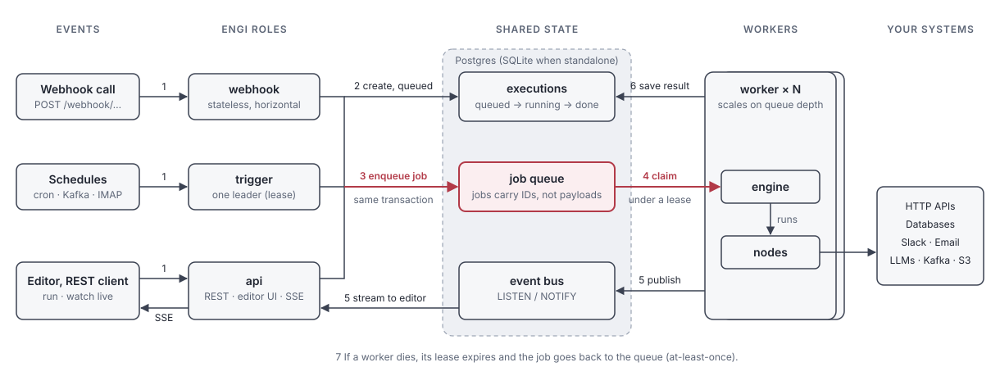

# 2. Architecture

## 2.1 Code architecture (Clean / Hexagonal)

```
cmd/engi ──► internal/app (composition root)
                 │ wires
                 ▼
   ┌──────────── adapters ────────────┐
   │ http/api  http/webhook  store/*  │
   │ queue/*   bus/*   blob/*  lease/* │
   └───────────────┬──────────────────┘
                   │ implement
                   ▼
            internal/port  (interfaces)
                   ▲ used by
            internal/service (use cases: engine, workflow, execution, credential, trigger)
                   ▲ uses
            internal/domain (entities, value objects, domain errors; stdlib only)
```

Repository layout:

```
cmd/engi/                 main: CLI (serve, worker, run, migrate, version)
                          `engi worker` is shorthand for `engi serve --roles=worker`
internal/config/          typed config, defaults, loading, validation
internal/domain/          workflow, node, connection, item, execution, credential
internal/port/            Store, Queue, Bus, BlobStore, LeaseProvider, Clock, Cipher ...
internal/service/
  engine/                 executes a workflow (pure, no I/O except through ports)
  expression/             {{ }} evaluation
  workflow/ execution/ credential/ trigger/
internal/node/            built-in node implementations (one package per node)
internal/adapter/
  store/sqlite store/postgres
  queue/memory queue/postgres queue/redis queue/nats queue/kafka
  bus/memory bus/postgres bus/redis bus/nats
  blob/fs blob/s3
  lease/local lease/kubernetes lease/postgres
  http/api http/webhook http/ui
  plugin/                 out-of-process node host (any-language plugins)
internal/app/             builds the object graph per role
pkg/nodesdk/              public, versioned Go SDK for node authors
migrations/{sqlite,postgres}/
web/                      editor UI source (built and embedded with go:embed)
deploy/helm/engi/         Helm chart
docs/
```

### 2.1.1 Layering rules

The dependency rules of CLAUDE.md are enforced by the `depguard` rules in `.golangci.yml`. For adapters:

- An adapter may import `domain`, `port`, `service` and `pkg/` packages, and the shared infrastructure
  packages below. It may not import `internal/app`.
- **One port implementation never imports another.** Shared infrastructure packages are the only exception.
  They are libraries that several adapters of one backend build on, not alternatives a caller chooses
  between:
  - `internal/adapter/pgdb` (with its `pgdb/pgtest` helper): the Postgres pool, migrations, transaction
    runner and `LISTEN` helper. Used by the Postgres store, queue, bus, lease and lock adapters. Its
    `Runner` implements `port.TxManager`, which is why it is shared rather than hidden behind a port.
  - `internal/adapter/sqlitedb`: the same role for SQLite (store and queue).
  - `internal/adapter/jsoncodec`: the JSON wire and file format of domain and engine types (docs/03). Used by
    the HTTP API and the store adapters.
  - `internal/adapter/plugin/pluginnode`: adapts a plugin transport to the `nodesdk.Node` contract. The
    `httprpc` and `stdio` transports implement its `Caller` interface.
- Choosing an implementation by a runtime value is composition, so it lives in `internal/app`. The LLM
  provider factory (`internal/app/llm_providers.go`) maps a provider id to the `anthropic`, `openai` or
  `ollama` adapter, (docs/14).
- Test files may import other adapters. Contract and conformance suites run one suite against several
  implementations (for example `store/sqlite` and `store/postgres`, or the plugin transports).

## 2.2 Runtime roles

One binary. `engi serve --roles=...` chooses which roles a process runs. Standalone mode
runs all roles in one process.

| Role | Responsibility | Scaling |
|---|---|---|
| `api` | REST API, editor UI, live run stream | stateless, horizontal |
| `webhook` | Receives production webhook calls and enqueues executions | stateless, horizontal |
| `trigger` | Schedules, pollers, long-lived listeners (Kafka, IMAP, ...) | leader-elected, sharded later |
| `worker` | Claims queued executions and runs the engine | stateless, autoscale on queue depth |
| `runner` | Hosts everything that runs outside the Go process: non-JS Code nodes (Python, ...) and any-language plugins. Both use the same plugin protocol and isolation | pool, isolated |

## 2.3 Infrastructure by mode

| Concern | Standalone (default) | Cluster |
|---|---|---|
| Store | SQLite file | Postgres |
| Queue | SQLite `jobs` table (durable: queued jobs survive a restart) with an in-memory dispatcher | **Postgres `SKIP LOCKED` (default)**, Redis Streams, NATS JetStream, Kafka |
| Bus (pub/sub) | in-memory | Postgres `LISTEN/NOTIFY` (default), Redis, NATS |
| Blobs | local filesystem (`blob.driver: fs`) | S3 API (`blob.driver: s3`; MinIO, AWS, GCS interop), configured from server settings |
| Leader lease | local (always leader) | Kubernetes `Lease`, or Postgres advisory lock |

Cluster mode is `store.driver: postgres` (section 2.6, "Postgres adapters"); queue, bus and lease follow it
by default (`auto`) and can be overridden per concern.

**Minimum cluster dependency is Postgres only.** Redis, NATS and Kafka are optional
adapters for higher throughput, not requirements.

## 2.4 Execution flow (cluster)



*The numbers match the steps below. Standalone mode runs the same flow in one process, with SQLite in
place of Postgres and an in-memory bus.*

1. An event arrives at `webhook`, `trigger` or `api` (manual run).
2. An Execution row is created (`queued`). Large input goes to the blob store.
3. A job `{executionID}` is enqueued. Jobs carry IDs, never payloads.
4. A `worker` claims the job atomically with a lease and heartbeat, then runs the engine.
5. Progress events are published on the bus, and `api` streams them to the editor (SSE).
6. The result is persisted. A waiting webhook response is routed back over the bus.
7. If a worker dies, its lease expires and the job is re-queued (at-least-once delivery).

### 2.4.1 Execution service, worker and waiter (implemented)

`internal/service/execution` holds the use cases. `Start` creates the `queued` Execution and stores the
start node and input items in the execution state store (jobs carry IDs only), then enqueues the job, all
in one transaction; a repeated `dedupKey` returns the existing id with an error matching `domain.ErrDuplicate`.
`Cancel` marks a queued or waiting execution `canceled` at once and publishes `execution.cancel` for a running
one. `Retry` starts a new execution (mode `retry`) with the start node and items recovered from a failed
one. `RunSync` / `Await` wait for the result (bus event plus a store check every `worker.syncPollInterval`,
at most `worker.syncRunTimeout`, then `ErrSyncTimeout`; the execution keeps running).

`internal/service/worker` runs `worker.concurrency` slots. Each slot blocks in `JobDispatcher.Next`, loads
the execution and workflow version, builds the engine request (a saved input starts the run, a saved `State`
resumes it), marks the execution `running`, runs the engine with a per-execution cancelable context, and
stores the outcome (status, run data, error, `finishedAt`; a `waiting` execution keeps its `State` and gets
`waitUntil`; a finished one drops its saved state). A heartbeat goroutine extends the lease every
`queue.heartbeatInterval`; if the lease is lost the run is cut off and nothing is stored (the new owner
decides). Infrastructure errors `Fail` the job for a retry after `queue.retryDelay`; when its attempts are
used up the execution becomes `crashed`. A ticker (`worker.reclaimInterval`) calls `ReclaimExpired`: jobs of
dead workers go back to the queue, or their executions become `crashed` once attempts run out.
`Shutdown(ctx)` stops claiming, waits up to `worker.shutdownGrace` for running executions, then cancels them,
sets them back to `queued` and releases their jobs (the attempt is not counted).

`internal/service/waiter` resumes waiting executions (see page 4, section 4.6). The in-process event bus
(`port.Bus`, adapter `internal/adapter/bus/memory`) is best effort: each subscriber has a bounded buffer
(`worker.eventBuffer`) and loses events rather than blocking publishers; durable facts live in the stores.
Cancel of a running execution travels over the bus, so in a cluster the bus adapter must reach all workers.

`internal/app.Runtime` composes the standalone runtime (SQLite store and queue, memory bus, worker, waiter,
execution service): `Start(ctx)` / `Shutdown(ctx)`. `engi run --persist` goes through it: it stores the
workflow and the execution in `store.path`, runs them through the queue and a worker, and follows timed waits
until the execution finishes (an execution waiting for a signal ends the command with status `waiting`).

## 2.5 Cross-cutting concerns

- **Observability:** slog JSON logs always; metrics and traces are opt-in (`observability.*`, docs/11). Services depend on the
  `port.Metrics` and `port.Tracer` ports (no-op when disabled); the adapters are `adapter/metrics/prometheus` (own registry,
  `observability.metrics.path` on the main mux outside API auth, or its own `listen` address) and `adapter/telemetry/otel`
  (OTLP/HTTP). Metrics: executions started/finished by mode and status, execution and node duration histograms, queue depth,
  claim latency, busy worker slots, webhook requests by status, API requests by **route pattern** and status, trigger errors,
  Kafka consumers paused. Traces: one `engi.execution` span per run with an `engi.node` child per node run (ids, node
  name/type, run index and status only, never item data or credentials), an HTTP server span per request, and a client span
  per outbound request from the shared HTTP client. A W3C `traceparent` on an incoming request is stored with the execution
  input, so the worker continues the caller's trace across the queue.
- **Health:** `/healthz` (liveness), `/readyz` (dependencies reachable).
- **Shutdown:** on SIGTERM, stop claiming jobs, drain in-flight work within the configured grace period, and release leases.

## 2.6 Persistence

Implemented in `internal/adapter/store/sqlite`, `internal/adapter/queue/sqlite` and the shared
`internal/adapter/sqlitedb` (open, migrate, transactions). Ports: `WorkflowStore`,
`WorkflowVersionStore`, `ExecutionStore`, `ExecutionStateStore`, `CredentialStore`, `TxManager`,
`JobQueue`, `JobReclaimer`, `JobDispatcher` (`internal/port`).

**Schema** (`migrations/sqlite/NNNN_name.{up,down}.sql`, embedded, applied by a small migrator that
records versions in `schema_migrations`, one transaction per file):

| Table | Purpose |
|---|---|
| `workflows`, `workflow_tags` | Current definition (JSON text), `active`, `version`; tags are rows for filtering |
| `workflow_versions` | Immutable snapshot per save, key `(workflow_id, version)` |
| `executions` | Light, listable columns: status, mode, `started_at`, `finished_at`, `wait_until`, `dedup_key`, version FK |
| `execution_data` | Heavy columns kept apart: `run_data` JSON and one `state` blob: the start node and items of an execution that has not run yet, or the serialized engine `State` of a waiting one (`engine.StateCodec`; the blob is dropped when the execution finishes) |
| `credentials` | Ciphertext and `key_id` only |
| `jobs` | The durable queue |

Conventions that make a Postgres translation mechanical: text ULID ids, UTC timestamps as fixed-width
ISO-8601 text, JSON as text, partial indexes (`executions(wait_until) WHERE status='waiting'`, unique
`(workflow_id, dedup_key) WHERE dedup_key IS NOT NULL`, `jobs(available_at) WHERE status='queued'`),
and `UPDATE ... RETURNING` for claims. Deleting a workflow cascades to its versions, executions and jobs.

**Store semantics.** Every `Save` bumps the version and writes a snapshot; activation (`SetActive`)
does not. Lists are newest first with opaque keyset cursors; `Executions.List` omits run data.
A repeated `(workflow_id, dedup_key)` fails with `domain.ErrDuplicate` (`*domain.DuplicateError` names
the existing execution). `Prune` takes a cutoff per terminal status, so retention by status and age is
the caller's policy. `TxManager.WithinTx` carries a transaction in the context so an execution and its
job can be created atomically.

**Queue semantics.** At-least-once. `Claim` is one atomic `UPDATE ... RETURNING` on the oldest queued job
with `available_at <= now`; it sets the lease owner and expiry and counts an attempt. Workers extend the
lease with `Heartbeat` and end with `Complete` (row deleted), `Fail` (requeued at `retryAt`, or parked as
`failed` once attempts reach `queue.maxAttempts`) or `Release` (requeued, attempt not counted). Acting on
a job after losing the lease returns `domain.ErrLeaseLost`. `ReclaimExpired` requeues (or parks) jobs whose
lease ran out and returns them, so the caller can mark their executions `crashed`. `Next` blocks until a
job is claimable: `Enqueue` wakes in-process waiters through a broadcast channel, and
`queue.pollInterval` is the fallback for jobs enqueued by another process.

**Delivery guarantees.** Delivery is at-least-once. A worker that dies after storing a result but before its
ack (`Complete` or `Release`) leaves the job leased; when the lease expires the reclaimer requeues it, and the
next worker decides from the stored execution what to do with it:

- **Finished** (`success`, `error`, `canceled`, `crashed`): the job is completed without running anything. No
  node runs again and the finish event is not published twice.
- **Waiting** (state saved, `waitUntil` or a resume token): the stale job is completed without running. A
  waiting execution has no job of its own; the waiter (time) or `ResumeByToken` queues a fresh job when the
  wait is over. Nodes before the wait do not run again, and the wait is never cut short.
- **Interrupted mid-run** (`running`, partial run data): the execution goes back to `queued` and runs again
  from its last stored checkpoint. A fresh run restarts from its saved input; a resumed run restarts from its
  saved waiting state. Everything after that checkpoint runs again, so the nodes of the interrupted run are
  at-least-once: a side effect (an HTTP call, a sent email) of a node that completed before the crash can
  happen twice. The partial run data is replaced by the new run.

**One run at a time.** A job runs the engine only if it wins the claim: `ExecutionStore.ClaimRun` moves the
execution from `queued` to `running` in one conditional write, and that write also counts the attempt and
records the holder: the job and its claim attempt. A job that loses the claim is a duplicate (a time or token
resume can queue a fresh job while the stale job still holds its lease). It is completed without running and
logged at INFO. A job may take over a run it already holds at an earlier claim: a reclaimed job claimed before
the reclaim requeued the run takes the run back, and that takeover counts as a recovery. A reclaim or retry
requeues a run only while its own claim is the holder (`RequeueRun`), so a late requeue from an earlier claim
cannot reset a run that a newer claim drives.

Results are fenced the same way. Finishing, waiting and crashing write only while the claim still holds the
run (`FinishRun`, `CrashRun`), and the state save of a waiting run is rolled back with them. A zombie worker
whose claim was taken over therefore cannot overwrite the newer holder's result. It logs at WARN, publishes no
event, starts no error workflow, and completes its job. A crash can also end a queued execution, since no
claim holds it once its job ran out of attempts.

**Attempts.** Each claim that starts a run counts in `attempts`, and a takeover from a dead worker also sets
`lastRecoveredAt`. Both are on the execution (see [page 3](03-data-model.md#35-execution)) and in the editor's
timeline, which shows "attempt N" when the run started more than once.

**SQLite settings** (`store.*`, `queue.*` in `internal/config`; env `ENGI_STORE_*`, `ENGI_QUEUE_*`): WAL journal,
busy timeout, synchronous level, pool sizes, page sizes, lease and heartbeat durations, poll interval,
max attempts, retry delay. Connections use `BEGIN IMMEDIATE` so transactions never fail on lock upgrade.

**Contract tests.** `internal/port/porttest` holds the store and queue suites as functions that take a
constructor; the SQLite adapters run them on a temp-file database per test, and the Postgres adapters run
the same suites (build tag `integration`, Postgres in Docker through testcontainers).

**Postgres adapters** (cluster mode, `store.driver: postgres`). `internal/adapter/pgdb` opens the pool
(pgx stdlib, DSN from env/file), carries transactions in the context like `sqlitedb`, applies
`migrations/postgres` (advisory-locked so replicas can start together), and provides the reconnecting
`LISTEN` helper. `store/postgres` mirrors the SQLite store statement for statement with native types
(`timestamptz`, `jsonb` definitions and run data, `boolean`, `bytea`, `COLLATE "C"` ids so keyset cursors order
like the SQLite store); `Runner.Do` uses a savepoint inside an ambient transaction because Postgres aborts a
transaction on any error. `queue/postgres` claims with `UPDATE ... WHERE id = (SELECT ... FOR UPDATE SKIP
LOCKED LIMIT 1) RETURNING`, so concurrent pods never claim the same job; `pg_notify('engi_jobs')` on enqueue
and requeue wakes the dispatchers of every pod (delivered at commit when inside a transaction), with
`queue.pollInterval` as the fallback; `QueueStats.Depth` is a count of queued rows. `bus/postgres` publishes
with `pg_notify('engi_events')`; payloads over `bus.maxInlineBytes` are stored in `bus_events` and only the
id is notified; each pod has one dedicated listener connection that reconnects and fans events out to
local subscribers (best-effort, as the port promises). `lease/postgres` holds a session-level advisory lock
on a dedicated connection: it cancels the leader context and waits for the callback before releasing, and
re-campaigns on a new connection when the connection check fails.

---
**← Previous** [1. Vision](01-vision.md) · **Index** [README](README.md) · **Next →** [3. Data Model](03-data-model.md)
