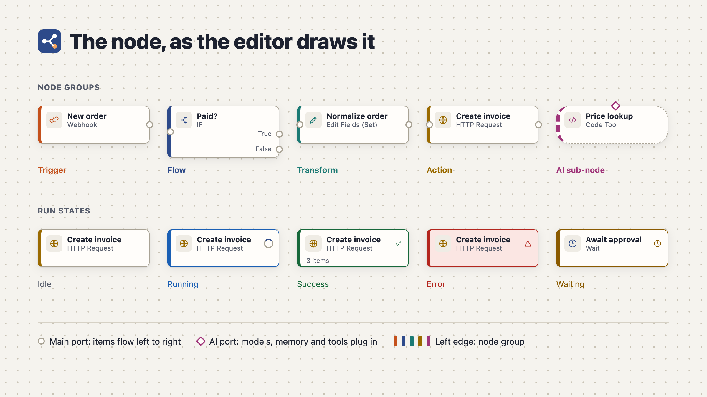

# 10. Editor UI

Source in `web/`: React + TypeScript + [React Flow](https://reactflow.dev) (MIT) for the
canvas. The production build is embedded with `go:embed` and served by the `api` role
(`internal/adapter/http/ui`), so the single binary ships its own editor. No CDN, no
telemetry, no external fonts: it works air-gapped.

## 10.1 Principles

- **Descriptor-driven.** The UI knows no node by name. Forms, ports, icons and credential pickers come from `GET /node-types` ([page 6](06-nodes-and-plugins.md)). A new node needs no UI change.
- **Own visual design.** Engi has its own look: its layout, colours, icons and copy are its own and are not copied from other products. Icons come from Engi's own icon set (keys in Descriptors).
- **Server is the authority.** The UI validates for convenience; the API validates for real.
- Small bundle: route-level code splitting; the code editor and JSON viewer load lazily.

## 10.2 Screens

| Screen | Purpose |
|---|---|
| Workflows | List, search, tags, activate toggle, import/export |
| Editor | Canvas, palette, node panel, run view |
| Executions | Filterable list (status, workflow, mode, date), open any run on the canvas |
| Credentials | Create, edit, test, reconnect (OAuth2) |
| Variables, Users, API keys, Settings | Admin forms |

## 10.3 Canvas

- Nodes are cards with a title, icon, status badge and typed ports. Port colour and shape encode kind (`main` vs `ai.*` sub-ports).
- Connect by drag; invalid connections (kind mismatch, cycles when disallowed) are refused with an inline reason.
- Multi-select, copy/paste (as workflow JSON, usable across instances), align, auto-layout, minimap, sticky notes (below), zoom to fit.
- Undo/redo is a local command stack over the workflow document. Save creates a new version; autosave is a draft until saved.
- Concurrent edit protection uses the workflow `version` (`If-Match`); a conflict shows a diff-and-choose dialog.

## 10.4 Node palette and forms

- **Palette:** opened by `+` or `Tab`; fuzzy search over display name, group and description; grouped by `Trigger | Action | Transform | Flow | AI`; recently used first.
- **Parameter forms** render each property type from [section 6.2](06-nodes-and-plugins.md#62-property-schema):

| Property type | Control |
|---|---|
| `string`, `number`, `boolean` | text / numeric / switch, each with a "fixed ↔ expression" toggle |
| `options`, `multiOptions` | select / checkbox list |
| `json`, `code` | lazy-loaded code editor with syntax highlighting |
| `dateTime` | picker with timezone |
| `collection`, `fixedCollection` | optional-field adder / repeatable group |
| `resourceLocator` | list / ID / URL modes with search against the node |
| `credentialsSelect` | credential picker filtered by type, with inline "create" and test |
| `notice` | static callout |

`displayOptions` re-evaluate on every change; hidden fields keep their values but are not sent to validation.

## 10.5 Expression editor

- A parameter starting with `=` switches to an expression field (`{{ }}` highlighted).
- **Autocomplete** for scope from [page 5](05-expressions.md): `$json` fields inferred from the last run data of the parent node, `$("Node")` names, `$vars`, `$fn` helpers.
- **Live preview** evaluates the template against the selected input item through `POST /expressions/preview` (sandboxed server-side; same limits as runtime) and shows the result or the `ExpressionError` inline.
- Drag a field from the input panel onto a parameter to insert `{{ $json.field }}`.

## 10.6 Running and the run view

- **Run workflow**, **Run to this node** (partial run, `destination`), **Execute node** (single node using parent output or pin data).
- **Live progress** over SSE ([page 9, section 9.5](09-api.md#95-live-execution-stream-sse)): nodes show running/success/error, item counts on edges, and waiting state.
- **Node data panel:** input on the left, output on the right, per run index and branch. Views: **Table**, **JSON** (collapsible, searchable), **Binary** (metadata, preview, download; see "Binary data and workflow settings" below). Large outputs are paged; truncated items are fetched on demand.
- **Pin data:** pin a node's output from a run or paste JSON; pinned nodes show a marker and are skipped by the engine. Pins are saved with the workflow and excluded from production runs.
- Errors show node, message, description and the failing item index, with a jump to the node.

### Pinned data, partial runs and server previews

- **Pin data.** In a node's Data tab, "Pin output" stores the last output (item `json` objects) in the workflow's `pinData`, saved with the workflow. "Edit pinned data" opens a JSON editor that accepts only an array of objects; "Unpin" removes it. Pinned nodes show a pin badge on the canvas, and every run sends `pinData`.
- **Partial runs.** The node panel offers "Run to here" (`destination` inclusive) and "Run up to here" (exclusive). They send the current unsaved document in `workflow`, so saving first is not needed, and reuse the live SSE progress.
- **Expression preview.** Expression fields call `POST /expressions/preview` (debounced, in-flight requests aborted) against the open execution or the workflow's newest one, and show the value or the evaluator's error. If the server cannot evaluate (for example no past execution), the field falls back to the local data-path preview.

## 10.7 Import / export

- Export a workflow or selection as JSON in the wire format of [page 3](03-data-model.md). Credentials export as references (`id`, `name`, `type`) only, never secrets.
- Import by file, paste or drop onto the canvas. Missing credentials are listed for remapping; unknown node types import as disabled placeholders with a warning.
- Importing JSON from other workflow tools is out of scope here (a separate converter tool may come).

## 10.8 Accessibility and keyboard

- Target WCAG 2.2 AA: contrast in light and dark themes, visible focus, no information by colour alone, `prefers-reduced-motion` respected.
- The canvas is keyboard-operable: nodes are focusable, arrows move focus between connected nodes, `Enter` opens a node, and a "connect from here" mode links nodes without a mouse. ARIA labels carry node name, type and status; run status changes use a polite live region.
- All dialogs trap and restore focus. Every action is reachable from the command palette.

| Shortcut | Action |
|---|---|
| `Tab` / `+` | Open node palette |
| `Ctrl/Cmd+K` | Command palette |
| `Ctrl/Cmd+S` | Save |
| `Ctrl/Cmd+Enter` | Run workflow |
| `Ctrl/Cmd+Z` / `Shift+Z` | Undo / redo |
| `Ctrl/Cmd+C` / `V` / `D` | Copy / paste / duplicate |
| `Delete` | Remove selection |
| `D` | Disable / enable selected node |
| `P` | Pin output |
| `N` | Add a sticky note |
| `Ctrl/Cmd+Shift+L` | Tidy up (auto-layout) |
| `H` | Version history panel |
| `?` | Shortcut help |

UI strings live in message catalogues (English first) so translation does not touch components.

## 10.9 As built (milestone 3a)

Source: `web/` (Vite, React 18, TypeScript strict, `@xyflow/react`, TanStack Query, react-router, CodeMirror 6). Served by `internal/adapter/http/ui`.

**Delivered**

- Auth: first-run setup (`GET /auth/setup`), login, logout. Session cookie plus the CSRF token from login or `GET /me`, sent on every non-GET request; a 401 anywhere returns the user to the login page.
- Workflows list: search, active toggle, create, import (file or paste), export, delete, cursor "load more".
- Sub-ports: a node with `ai.*` inputs (the AI Agent) shows them along the bottom edge, labelled by kind (`*` marks a required one); a sub-node (model, memory, tool) shows its output on top and has a rounded dashed card. Dragging only accepts a matching kind, and a full input (`maxConnections`) refuses another link. Connections store the index among ports of their kind, so the canvas converts to and from descriptor positions. The data tab of an AI Agent lists its tool calls (`steps`) above the output table.
- Canvas: searchable palette (`+` or `Tab`, recent first), connect by drag or by keyboard ("connect from here", `C` then `Enter`), port counts and names from descriptors (IF true/false, Switch outputs, Merge inputs), kind and duplicate checks with an inline reason, move, rename with unique names (connections follow), disable, delete, copy/paste/duplicate as workflow JSON through the system clipboard, undo/redo (coalesced command stack), save (new version, `If-Match`), a diff-and-choose dialog on a 409, an unsaved-changes guard (router blocker and `beforeunload`), minimap, zoom, command palette (`Ctrl/Cmd+K`) and shortcut help (`?`).
- Node panel: forms rendered only from descriptors for `string`, `number`, `boolean`, `options`, `multiOptions`, `json`, `code`, `dateTime`, `collection`, `fixedCollection`, `credentialsSelect` and `notice`; `displayOptions` show/hide, defaults and required checks; a fixed/expression toggle per field (`=` prefix) with a CodeMirror editor that highlights `{{ }}`, completes the basic variables (`$json.<field from the last run>`, `$("Node")` names, `$vars`, ...) and shows a **live preview**; credential slots (shown only when the parameter that selects them is chosen) with inline create; node settings (retry, onError, alwaysOutputData, executeOnce, timeout, notes) through the same form renderer.
- Run and inspect: **Run workflow** saves first if needed, then `POST /workflows/{id}/run` and follows `/executions/{id}/stream`; node cards show running, succeeded, failed or waiting and edges show item counts; if the stream drops the page polls. The Data tab of a node shows input and output per run index and output branch as a table or a collapsible, filterable JSON tree (paged). **Listen for test webhook** arms `POST /workflows/{id}/test-webhook`, shows the URL and attaches to the execution it triggers. The Executions page filters by status and workflow and offers open, retry, cancel and delete; opening one shows it **read-only on the canvas**, using the workflow version it ran with.
- Credentials: list, create and edit from the credential type schema, secrets as the redaction sentinel (`Replace` to change), test connection, OAuth2 authorize. Set `server.oauth2CompleteRedirect` to `/credentials` to land back on the list after authorizing.
- Settings (`/settings`): **Profile** (own name, email, password via `PATCH /users/{id}`), **Users** (owner only, hidden for members by `/me` role: list, add member, disable/enable) and **API keys** (list with prefix, scopes, created, last used, expiry; create with scope read|write and optional expiry; the token is shown once in a dialog with a copy button and warning; revoke asks to confirm). Validation errors from problem+json `errors[]` are shown beside the matching field. Source: `web/src/settings/`.
- Own visual design: CSS-variable tokens in `web/src/styles/tokens.css` (light and dark, follows the OS, manual override), own icon set keyed by descriptor `icon`, no external fonts or CDN. UI strings are in `web/src/i18n/en.ts`.
- Version history: the clock button or `H` opens a side panel listing `GET /workflows/{id}/versions` (newest first, cursor "Load more"; the API returns no author, so only number and date show). Selecting a version shows it read-only on the canvas with a banner offering **Back to current** and **Restore this version** (`POST .../restore`; confirms first when there are unsaved changes, then reloads the editor from the response; a 409 shows an inline message). Source: `web/src/editor/VersionHistory.tsx`.

**Differences from the plan above**

- Expression preview is computed in the browser, and only for plain data paths (`$json.a.b[0]`, `$("Node").item.json.x`, `$node["Node"].json.x`), because the API has no `/expressions/preview` endpoint yet and the browser must never run user code. Anything else says it is evaluated at run time.
- Not built yet (3b): pin data, partial runs (**Run to this node**, **Execute node**), `resourceLocator` (falls back to a text field), sticky notes, auto-layout, drag-from-input-panel, tags (version history is built, below), and the Variables screen.
- The node panel is a side drawer, not a modal; input and output are tabs of the same panel.
- A node type id ending in `.webhook` decides whether the "Listen" button shows. Everything else is descriptor-driven.

## Chat trigger: Open chat

The node panel of a Chat Trigger (`engi.trigger.chat`) shows an **Open chat** link that opens the hosted
widget (`<chatBasePath>/<path>/widget`) in a new tab. The chat is served only while the saved workflow is active, and the
test-listen mechanism (armed one-shot test URLs in manual mode) is specific to webhooks, so the button is
disabled with the reason instead when the workflow is inactive, the node is not saved yet, or authentication is
not `none`. The base path is the server's `chat.basePath`, read from `editor.chatBasePath` in `GET /me`, so the
editor follows the server setting with no build-time variable. Strings are in `en.ts` (`chat.*`). Source:
`web/src/editor/OpenChatButton.tsx`. Details: [AI, chat trigger](14-ai.md#chat-trigger).

## Server settings in the editor

`GET /me` (read at sign-in and at start, see [page 9](09-api.md)) carries an `editor` object with the server
settings the editor needs: `chatBasePath` (`chat.basePath`) and `maxNoteTextBytes` (`workflow.maxNoteTextBytes`).
The UI reads them through `useEditorSettings()` in `web/src/auth/AuthContext.tsx`; nothing is baked into the build.

---
**← Previous** [9. HTTP API](09-api.md) · **Index** [README](README.md) · **Next →** [11. Deployment & Configuration](11-deployment.md)

### Tidy up (auto-layout)

`editor/layout.ts` lays the graph out left to right: longest-path layering (back edges of loops are ignored), then one barycenter pass per layer. Roots go in column 0, merges land after their latest input, disconnected nodes wrap into rows below. It acts on the selection when 2+ nodes are selected (anchored at the selection's top-left), otherwise on the whole workflow, is a single undo step, and refits the view. All spacing lives in `LAYOUT_CONFIG`.

Because the engine runs sibling branches in canvas top-to-bottom order, the layout stacks siblings by output port (IF true above false, Switch outputs in order) and keeps the existing vertical order of siblings that share a port (covered by `layout.test.ts`).

**Sticky notes** stay with the graph: a note moves with the node it overlaps most, by the same distance, and a note over no node, or over a node that stays where it is, does not move. Overlap uses an approximate card footprint (`LAYOUT_CONFIG.nodeWidth` x `nodeHeight`), since the layout works on positions only.

## Tags and variables

- **Tags**: the workflows list filters by tag chips (`GET /workflows?tag=NAME`) and shows each row's tags. The editor bar has a tag editor (pick an existing tag from suggestions or type a new one); tags are part of the workflow document, so changing them marks it unsaved. Settings -> Tags renames or deletes a tag across all workflows (delete asks for confirmation).
- **Variables**: Settings -> Variables lists, creates, edits and deletes variables. Keys must match `[A-Za-z_][A-Za-z0-9_]*` (409 on duplicates). Secret values are returned as `__ENGI_SECRET__`; leaving it unchanged keeps the stored value, and turning `secret` off requires a new value. Expression autocomplete offers `$vars.<key>` from this list.

## Binary data and workflow settings

- **Execution timeline.** When the editor shows an execution (a past one or the live run), the **Timeline** button in the editor bar opens a panel with a summary (copyable id, status, mode, workflow version, start, duration, error node and message, or the wait-until time) and one row per node run, sorted by start time: status, attempts when above 1, items in and out, duration, and a bar placed and sized against the whole execution (minimum width in `TIMELINE_MIN_BAR_PCT`). Clicking a row opens that node. It uses only `runData`; runs with no start time sort last. Source: `web/src/editor/Timeline.tsx`.
- **Live executions list.** The Executions page refetches every `EXECUTIONS_REFRESH_MS` (`web/src/config.ts`) while the **Live** toggle (on by default) is pressed. The list API returns no `runData`, so there is no node-run count column.
- **Binary values** in a node's input or output (`item.binary`: `ref`, `mime`, `name`, `size`) are listed under the table or JSON view with name, MIME type, human size and a **Download** link to `GET /executions/{id}/binary/{ref}` (a `blob://<execution>/<id>` ref names its own execution). Source: `web/src/editor/BinaryList.tsx`, `binary.ts`.
- **Previews** use plain same-origin URLs, so the session cookie applies and no `blob:` URL is needed: images (PNG, JPEG, GIF, WebP) in an `img`, audio and video in native players (`preload="none"`), all through `?inline=true`. Text (`text/*`, JSON, XML) loads on a click, is capped by `BINARY_PREVIEW_MAX_BYTES` (`web/src/config.ts`, 512 KB; larger values are download-only, a body larger than the cap is cut) and renders in a `pre` as text, never as markup. SVG, PDF and everything else are download-only: the server serves them as attachments, and its `Content-Security-Policy: sandbox` response header stops the browser's PDF viewer, so a PDF `iframe` would show nothing.
- **CSP:** the default editor policy already allows what is used (`img-src 'self'`, media from `default-src 'self'`); nothing was loosened. An operator-supplied `server.ui.contentSecurityPolicy` must keep `'self'` for `img-src` and `media-src`.
- **Workflow settings** (button in the editor bar, or the command palette) edit `settings.*` of the open document: the **error workflow** (searchable list from `GET /workflows`, plus "None" and "This workflow"; a warning, not an error, when the chosen workflow has no enabled `engi.trigger.error` node, checked with `GET /workflows/{id}`) and the **execution timeout** in seconds (0 = server default). **Apply** marks the document unsaved; the normal save, with its version check and conflict dialog, stores it. The server rejects a newly chosen error workflow that does not exist (validation error at `settings.errorWorkflowId`). `saveSuccessData` exists in the document but nothing enforces it yet, so it has no control. Source: `web/src/editor/WorkflowSettings.tsx`.

## Sticky notes

Notes annotate the canvas; they are stored in the workflow's `notes` array, separate from nodes (data model: [3.9](03-data-model.md#39-sticky-notes), including why they are not a node type).

- **Create** with the note button in the editor bar, the `N` key (a bare key, ignored while typing) or "Add sticky note" in the command palette. The note appears at the centre of the view, 240 x 160, yellow.
- **Edit** by double-clicking: a textarea takes the markdown, and leaving it (click elsewhere, Tab or Escape) saves. An empty note shows a hint.
- **Size limit.** The text is limited to `maxNoteTextBytes` from the server (default 16 KiB) and counted in **UTF-8 bytes**, not characters, so `é` is 2 bytes and an emoji is 4. While editing, a counter (`used / max bytes`) shows in the corner and turns red when the text is over the limit. An edit that would grow the text past the limit is refused, paste included; a text already over the limit (after the server lowered it) can still be shortened. The server answers 422 to a save over the limit, so this is convenience, not the check.
- **Render**: a small renderer in `web/src/editor/Markdown.tsx` builds React elements, never HTML. It supports headings, paragraphs, bullet and numbered lists, block quotes, fenced and inline code, rules, bold, italic and strikethrough. Raw HTML shows up as text; images are not rendered; a link is live only for `http`, `https` and `mailto`, opens in a new tab with `rel="noopener noreferrer nofollow"`, and any other scheme (`javascript:`, `data:`, relative) renders as plain text. No markdown library is used: the subset is small, and a hand-written element builder has no HTML escape hatch to get wrong.
- **Colour** comes from the fixed palette in `web/src/editor/notes.ts` (`NOTE_COLORS`), shown as swatches in the toolbar above a selected note. The shades are theme tokens `--note-<name>-bg` and `--note-<name>-border` in `styles/tokens.css`, defined for light and dark.
- **Move and resize**: drag a note to move it; drag a corner or edge of a selected note to resize (minimum 100 x 60). Notes select, move, copy, paste, duplicate and delete together with nodes (`Delete`, `Ctrl/Cmd+C`, `V`, `D`). A copied fragment includes the selected notes; pasting gives them new ids and shifts them by 40 units.
- **Z-order**: notes are drawn behind nodes and edges, and selecting one does not lift it above nodes.
- **Canvas ids.** React Flow ids carry the kind: a node is `node:<name>` and a note is `note:<id>`. Node names are free text, so a node named `note:nt_1` cannot take the id of a note. The two prefixes never prefix each other (`web/src/editor/canvasIds.ts`).
- **Conflict dialog.** A save that hits a version conflict lists notes with the nodes: notes only in your copy, only on the server, and different in both, each named by its first line (or its id when empty).
- **Undo and redo** cover every note change, since notes are part of the document the history tracks. A change marks the document unsaved; saving stores it with the next version, and version history, restore, export and import carry notes. Past executions and old versions show the notes of that version, read-only.
- The minimap draws notes in their colour. Notes never take part in runs, so they have no ports and no run state.

---

**← Previous** [9. HTTP API](09-api.md) · **Index** [README](README.md) · **Next →** [11. Deployment & Configuration](11-deployment.md)
