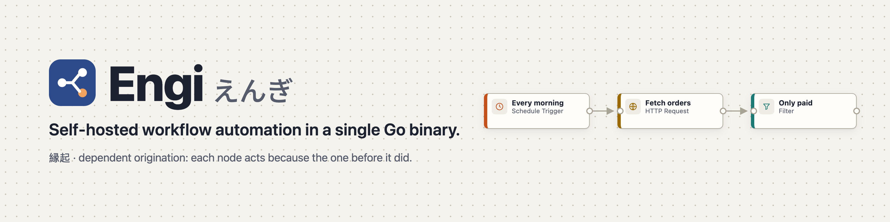
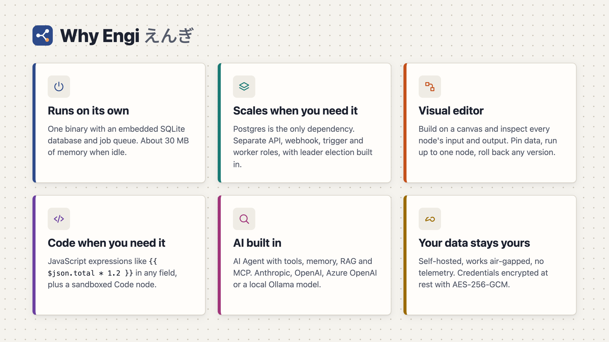
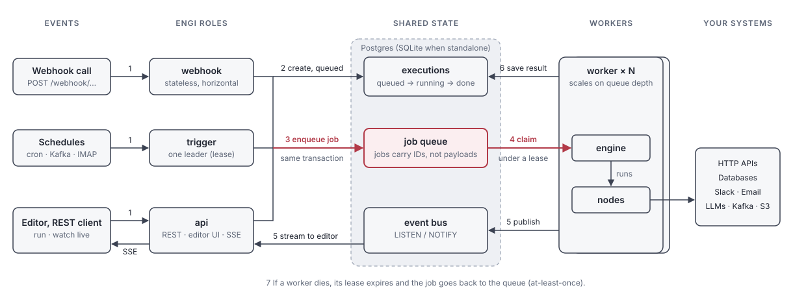

# Engi Documentation

> **縁起 (えんぎ, Engi): Dependent Origination.** Nothing exists in a vacuum. A node cannot act
> until an event triggers it, and its output is useless until it is passed to the next
> node. Nodes *co-arise* to create a function.

Engi is a lightweight, self-hosted workflow automation platform. It is a single Go binary
that runs alone on a laptop or server, or scales out on Kubernetes. You connect data
sources, build workflows, and they run.

<video controls muted playsinline preload="metadata" poster="assets/brand/engi-intro-poster.png" style="width:100%;border-radius:8px" aria-label="Engi in 10 seconds: a workflow is built on the canvas, then runs node by node.">
  <source src="assets/brand/engi-intro.mp4" type="video/mp4">
</video>

[Watch the 10-second intro (MP4)](assets/brand/engi-intro.mp4)

How a run moves through Engi is explained in [Architecture §2.4](02-architecture.md#24-execution-flow-cluster).

## Pages

| # | Page | Covers |
|---|---|---|
| 0 | [Quick Start](00-quick-start.md) | Install, run the editor, first workflow |
| 1 | [Vision & Principles](01-vision.md) | Why Engi, design rules, non-goals |
| 2 | [Architecture](02-architecture.md) | Clean architecture, single binary, roles, scaling |
| 3 | [Data Model](03-data-model.md) | Workflow, Node, Connection, Item, Execution, Credential |
| 4 | [Execution Engine](04-engine.md) | Ordering, merging, errors, retries, waits |
| 5 | [Expressions](05-expressions.md) | `{{ }}` syntax, variables, sandbox |
| 6 | [Nodes & Plugins](06-nodes-and-plugins.md) | Node contract, built-in nodes, any-language plugins |
| 7 | [Data Sources & Credentials](07-data-sources.md) | Connections, encryption, OAuth2 |
| 8 | [Triggers & Webhooks](08-triggers.md) | Webhook, schedule, polling, streaming listeners |
| 9 | [HTTP API](09-api.md) | REST endpoints, auth, live execution stream |
| 10 | [Editor UI](10-editor-ui.md) | Canvas, node panel, run view |
| 11 | [Deployment & Configuration](11-deployment.md) | Standalone, Docker, Compose, Helm, config reference |
| 12 | [Feature Plan & Roadmap](12-roadmap.md) | Phases, milestones, concept checklist |
| 13 | [Developer Guide](13-dev-guide.md) | Repo layout, build, test, graphify, agent workflow |
| 14 | [AI](14-ai.md) | Chat models, providers, tool contract, `engi.ai.chat` |
| 15 | [Plugins](15-plugins.md) | Plugin Protocol v1, manifest, install, SDKs, Python Code node |
| - | [Node Reference](nodes/README.md) | Per-node parameters, ports and credentials, generated from the descriptors |

These pages are also published as a website: <https://engi-hq.github.io/docs/>.

**Next →** [Quick Start](00-quick-start.md)
