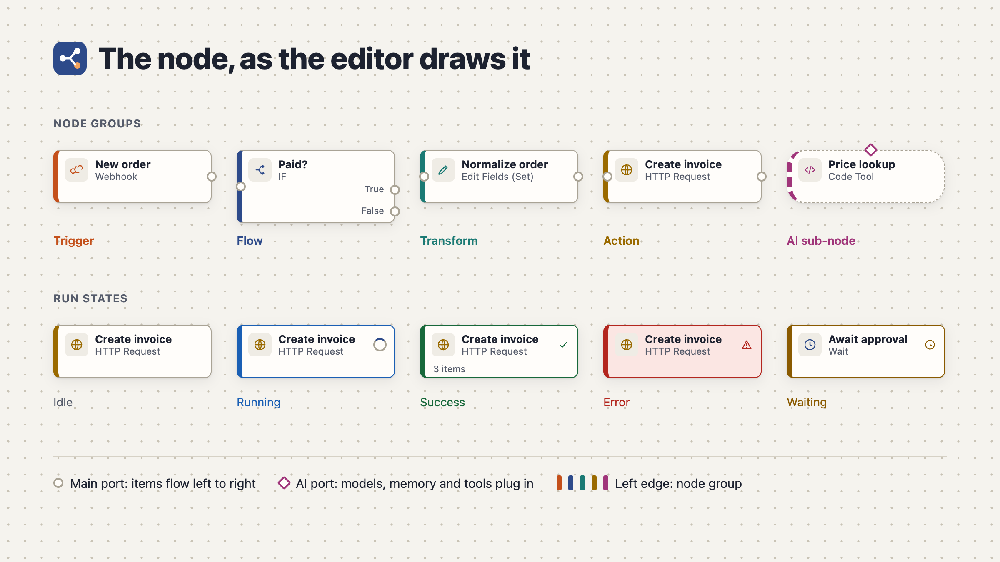

# Node Reference

Reference for every built-in node. The **Parameters**, **Inputs**, **Outputs** and **Credentials**
tables on each page are generated from the node descriptors, the same source the editor uses,
so they cannot drift from the code. The prose around them is hand-written.

## How to read a node page

- **Type / Version / Group** identify the node in workflow JSON (`type`, `typeVersion`).
- **Inputs / Outputs** list ports by index; the `main` kind carries items.
- **Credentials** lists the slots a node reads and the credential type each accepts (see [Credential Types](11-credentials.md)).
- **Parameters** shows each field's type, default, allowed options and the condition under which the editor shows it. Nested fields appear as `parent.child` rows prefixed with an arrow. Any string parameter may be an [expression](../05-expressions.md).

## Items in one paragraph

Data moves between nodes as a list of items, each with a JSON `json` object and optional binary
attachments. A node runs once per input batch, emits items on one or more output ports, and the
engine passes them to the connected nodes. See the [data model](../03-data-model.md), the
[engine](../04-engine.md) and [expressions](../05-expressions.md).

## All nodes

<!-- BEGIN GENERATED: index -->
| Node | Type | Group | Purpose |
|---|---|---|---|
| [Manual Trigger](01-triggers.md#manual-trigger) | `engi.trigger.manual` | `trigger` | Starts the workflow when you run it by hand. |
| [Webhook](01-triggers.md#webhook) | `engi.trigger.webhook` | `trigger` | Starts the workflow when its URL is called. |
| [Schedule Trigger](01-triggers.md#schedule-trigger) | `engi.trigger.schedule` | `trigger` | Starts the workflow on an interval or a cron expression. |
| [Execute Workflow Trigger](01-triggers.md#execute-workflow-trigger) | `engi.trigger.executeWorkflow` | `trigger` | Starts the workflow when another workflow calls it. |
| [Error Trigger](01-triggers.md#error-trigger) | `engi.trigger.error` | `trigger` | Starts the workflow when an execution of another workflow fails and this workflow is its error workflow. |
| [Kafka Trigger](01-triggers.md#kafka-trigger) | `engi.trigger.kafka` | `trigger` | Starts the workflow for messages (or batches) of Kafka topics. |
| [IMAP Trigger](01-triggers.md#imap-trigger) | `engi.trigger.imap` | `trigger` | Starts the workflow for every new mail of an IMAP mailbox. |
| [Chat Trigger](01-triggers.md#chat-trigger) | `engi.trigger.chat` | `trigger` | Starts the workflow for each chat message and answers with the workflow's reply. |
| [MCP Server Trigger](01-triggers.md#mcp-server-trigger) | `engi.trigger.mcpServer` | `trigger` | Exposes workflows as tools of a Model Context Protocol server while this workflow is active. |
| [IF](02-flow.md#if) | `engi.flow.if` | `flow` | Route items to the true or false output depending on conditions. |
| [Switch](02-flow.md#switch) | `engi.flow.switch` | `flow` | Route items to different outputs. |
| [Merge](02-flow.md#merge) | `engi.flow.merge` | `flow` | Combine the items of several inputs. |
| [Wait](02-flow.md#wait) | `engi.flow.wait` | `flow` | Pause the execution, then continue with the same items. |
| [Execute Workflow](02-flow.md#execute-workflow) | `engi.flow.executeWorkflow` | `flow` | Run another workflow with these items. |
| [Respond to Webhook](02-flow.md#respond-to-webhook) | `engi.flow.respondToWebhook` | `flow` | Answer the webhook call that started this execution, then continue. |
| [No Operation](02-flow.md#no-operation) | `engi.flow.noop` | `flow` | Passes the items through unchanged. |
| [Edit Fields (Set)](03-transform.md#edit-fields-set) | `engi.transform.set` | `transform` | Add, change or remove fields of each item. |
| [Filter](03-transform.md#filter) | `engi.transform.filter` | `transform` | Keep only the items that match the conditions. |
| [Sort](03-transform.md#sort) | `engi.transform.sort` | `transform` | Order items by one or more fields. |
| [Limit](03-transform.md#limit) | `engi.transform.limit` | `transform` | Keep only the first or last items. |
| [Split Out](03-transform.md#split-out) | `engi.transform.splitOut` | `transform` | Turn the elements of an array field into separate items. |
| [Aggregate](03-transform.md#aggregate) | `engi.transform.aggregate` | `transform` | Combine many items into one. |
| [Code (JavaScript)](04-code.md#code-javascript) | `engi.code.javascript` | `transform` | Run JavaScript in a sandbox to transform items. |
| [Code (Python)](04-code.md#code-python) | `engi.code.python` | `transform` | Run Python in a separate process to transform items. |
| [HTTP Request](05-http.md#http-request) | `engi.http.request` | `action` | Call an HTTP endpoint once per input item. |
| [Postgres](06-databases.md#postgres) | `engi.db.postgres` | `action` | Run SQL against Postgres: query, select, insert, update, upsert or delete. |
| [MySQL](06-databases.md#mysql) | `engi.db.mysql` | `action` | Run SQL against MySQL: query, select, insert, update, upsert or delete. |
| [Redis](06-databases.md#redis) | `engi.db.redis` | `action` | Read and write Redis keys, hashes and lists, list keys, and publish messages. |
| [MongoDB](06-databases.md#mongodb) | `engi.db.mongodb` | `action` | Query and modify MongoDB documents: find, find one and update, insert, update, delete or aggregate. |
| [Kafka](07-streaming.md#kafka) | `engi.kafka.produce` | `action` | Produce a message to a Kafka topic for every input item. |
| [S3 Storage](08-storage.md#s3-storage) | `engi.storage.s3` | `action` | Work with buckets and objects in AWS S3 or any S3-compatible store (MinIO, R2, ...). |
| [Send Email](09-email.md#send-email) | `engi.email.send` | `action` | Send one email per input item over SMTP. |
| [Slack](10-chat.md#slack) | `engi.chat.slack` | `action` | Post, update and delete Slack messages, upload text files, list channels and find users. |
| [Telegram](10-chat.md#telegram) | `engi.chat.telegram` | `action` | Send and edit Telegram messages, send documents by URL and read chat details. |
| [Microsoft Teams](10-chat.md#microsoft-teams) | `engi.chat.teams` | `action` | Send a card through a Teams incoming webhook, or post a channel message through Microsoft Graph. |
| [AI Agent](12-ai.md#ai-agent) | `engi.ai.agent` | `ai` | An agent that calls tools to answer: connect a model, optional memory and any number of tools. |
| [AI Model](12-ai.md#ai-model) | `engi.ai.model` | `ai` | The chat model an AI Agent uses: provider, credential, model and sampling options. |
| [Window Memory](12-ai.md#window-memory) | `engi.ai.memory.window` | `ai` | Remembers the last messages of a chat session for an AI Agent. |
| [Workflow Tool](12-ai.md#workflow-tool) | `engi.ai.tool.workflow` | `ai` | A tool that lets an agent run another workflow and read its result. |
| [HTTP Tool](12-ai.md#http-tool) | `engi.ai.tool.http` | `ai` | A tool that lets an agent call an HTTP API with values it fills in. |
| [Code Tool](12-ai.md#code-tool) | `engi.ai.tool.code` | `ai` | A tool that lets an agent run your JavaScript in the sandbox of the Code node. |
| [MCP Client Tool](12-ai.md#mcp-client-tool) | `engi.ai.tool.mcp` | `ai` | Gives an agent the tools of a remote MCP (Model Context Protocol) server. |
| [Vector Search Tool](12-ai.md#vector-search-tool) | `engi.ai.tool.vectorSearch` | `ai` | A tool that lets an agent search a pgvector table (the one the Vector Store node fills) for relevant passages. |
| [AI Chat](12-ai.md#ai-chat) | `engi.ai.chat` | `ai` | Send a prompt to a chat model (Anthropic, OpenAI, Azure OpenAI or Ollama) for each item and get text or JSON back. |
| [Text Splitter](12-ai.md#text-splitter) | `engi.ai.textSplitter` | `ai` | Cuts long text into overlapping chunks for embedding. |
| [Embeddings](12-ai.md#embeddings) | `engi.ai.embeddings` | `ai` | An embedding model (OpenAI, Azure OpenAI or Ollama) that turns text into vectors. |
| [Vector Store](12-ai.md#vector-store) | `engi.ai.vectorStore` | `ai` | Insert, search and delete text chunks in a pgvector table of your PostgreSQL database. |
| [Google Sheets](13-spreadsheets.md#google-sheets) | `engi.google.sheets` | `action` | Append, read, update and clear rows of a Google Sheet, create tabs and list them. |
| [Airtable](13-spreadsheets.md#airtable) | `engi.airtable` | `action` | List, get, create, update, upsert and delete Airtable records. |
<!-- END GENERATED: index -->

## Regenerating

Edit prose freely; never edit between the markers. After changing a descriptor run `make docs-nodes`.
`make check` fails if the tables are stale or a registered node has no section. To document a new
node, add `## Name` and a `<!-- BEGIN GENERATED: <type-id> -->` / `<!-- END GENERATED: <type-id> -->` pair to a group page.

---
**← Previous** [Docs index](../README.md) · **Index** [README](README.md) · **Next →** [1. Triggers](01-triggers.md)
